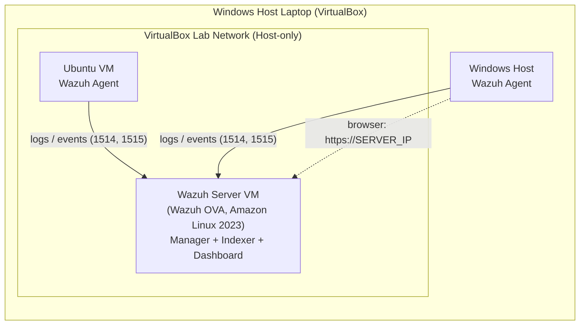

# HomeLab
# Wazuh Homelab: Centralized Log Monitoring & Threat Detection

A hands-on home lab that uses **Wazuh** (open-source SIEM/XDR) to collect, analyze, and alert on security events from two endpoints: an **Ubuntu VM** running in VirtualBox and a **Windows host** laptop. Everything runs on a single laptop.

> Status: work in progress

---

## Table of Contents

- [Goals](#goals)
- [Architecture](#architecture)
- [Lab Components](#lab-components)
- [Requirements](#requirements)
- [Setup Guide](#setup-guide)
- [Verification](#verification)
- [Detection Scenarios](#detection-scenarios)
- [Screenshots](#screenshots)
- [Troubleshooting](#troubleshooting)
- [Security Notes](#security-notes)
- [Roadmap](#roadmap)
- [Repository Structure](#repository-structure)
- [References](#references)

---

## Goals

- Deploy a working Wazuh server (manager, indexer, dashboard) on a laptop.
- Enroll a Linux endpoint and a Windows endpoint as agents.
- Collect and analyze system, authentication, and file-integrity logs.
- Generate real attack traffic and confirm Wazuh detects it.
- Write custom decoders/rules and document the results.

---

## Architecture



**Data flow:** agents collect logs and events on each endpoint and send them to the Wazuh manager. The manager decodes them and matches them against rules to generate alerts. Filebeat ships the alerts to the indexer, and the dashboard lets you search and visualize them.

---

## Lab Components

| Component | Role | OS | Notes |
|---|---|---|---|
| Wazuh Server | Manager, indexer, dashboard | Amazon Linux 2023 (Wazuh OVA) | Runs in VirtualBox |
| Endpoint 1 | Monitored Linux endpoint | Ubuntu (VirtualBox VM) | Wazuh agent installed |
| Endpoint 2 | Monitored Windows endpoint | Windows (host laptop) | Wazuh agent installed |
| Hypervisor | Runs the VMs | VirtualBox | Host-only + NAT networking |

| Item | Value |
|---|---|
| Wazuh version | `4.14.9` |
| VirtualBox version | `7.2.8` |
| Ubuntu version | `24.04.1` |
| Windows version | `11` |

---

## Requirements

**Hardware (host laptop)**
- 16 GB RAM recommended (8 GB minimum, but tight)
- 4+ CPU cores with virtualization (VT-x / AMD-V) enabled in BIOS/UEFI
- 100 GB free disk space

**VM sizing**

| VM | vCPU | RAM | Disk |
|---|---|---|---|
| Wazuh Server | 4 | 8 GB | 50 GB (from OVA) |
| Ubuntu endpoint | 2 | 2 GB | 25 GB |

**Software**
- [VirtualBox](https://www.virtualbox.org/)
- Wazuh OVA from the [official Wazuh docs](https://documentation.wazuh.com/current/installation-guide/virtual-machine.html)
- Ubuntu ISO (Desktop or Server)

---

## Setup Guide

### 1. Prepare the host

1. Enable virtualization (VT-x / AMD-V) in BIOS/UEFI.
2. Install VirtualBox.
3. Create a Host-only network: **File > Tools > Network Manager > Host-only Networks > Create**.

### 2. Import the Wazuh server

1. Download the Wazuh OVA and verify its checksum.
2. In VirtualBox: **File > Import Appliance** and select the OVA.
3. VM settings:
   - **System:** 8 GB RAM, 4 CPUs, enable *Hardware Clock in UTC Time*
   - **Display:** Graphics Controller set to *VMSVGA*
   - **Network:** Adapter 1 = NAT (internet), Adapter 2 = Host-only (lab network)
4. Start the VM, log in, and **change the default password immediately**.
5. Find the server IP and confirm services are running:

```bash
ip a
sudo systemctl enable --now wazuh-indexer wazuh-manager filebeat wazuh-dashboard
sudo systemctl status wazuh-indexer wazuh-manager filebeat wazuh-dashboard
```

6. Open `https://<WAZUH_SERVER_IP>` in a browser (accept the self-signed certificate) and change the default dashboard password.

### 3. Create the Ubuntu endpoint

1. Create a new VM and install Ubuntu from the ISO.
2. Network: Adapter 1 = NAT, Adapter 2 = Host-only (same network as the Wazuh server).
3. Confirm it can reach the server:

```bash
ping <WAZUH_SERVER_IP>
```

### 4. Enroll the Ubuntu agent

In the dashboard, go to **Endpoints Summary > Deploy new agent**, select **Linux (DEB)**, enter the server IP and an agent name (e.g. `ubuntu-vm`), then run the generated command on the VM:

```bash
# Command generated by the dashboard looks like:
wget https://packages.wazuh.com/4.x/apt/pool/main/w/wazuh-agent/wazuh-agent_<version>_amd64.deb \
  && sudo WAZUH_MANAGER='<WAZUH_SERVER_IP>' WAZUH_AGENT_NAME='ubuntu-vm' dpkg -i ./wazuh-agent_<version>_amd64.deb

sudo systemctl daemon-reload
sudo systemctl enable --now wazuh-agent
```

### 5. Enroll the Windows host agent

In the dashboard, select **Windows**, enter the server IP and an agent name (e.g. `windows-host`), then run the generated command in an **elevated PowerShell**:

```powershell
# Command generated by the dashboard looks like:
Invoke-WebRequest -Uri https://packages.wazuh.com/4.x/windows/wazuh-agent-<version>.msi -OutFile $env:tmp\wazuh-agent
msiexec.exe /i $env:tmp\wazuh-agent /q WAZUH_MANAGER='<WAZUH_SERVER_IP>' WAZUH_AGENT_NAME='windows-host'
NET START WazuhSvc
```

> Always copy the exact commands from your own dashboard, since package URLs and versions change between releases.

---

## Verification

- Dashboard shows both agents as **Active**.
- Events appear under **Threat Hunting** for each agent.
- File Integrity Monitoring and Security Configuration Assessment results are visible.

```bash
# On the Ubuntu endpoint
sudo systemctl status wazuh-agent
sudo tail -f /var/ossec/logs/ossec.log
```

```powershell
# On the Windows host
Get-Service WazuhSvc
```

---

## Detection Scenarios

| # | Scenario | Source | Expected result |
|---|---|---|---|
| 1 | Failed SSH logins (brute force) | Ubuntu auth logs | Authentication failure / brute-force alerts |
| 2 | Failed Windows logons | Windows Security log | Logon failure alerts |
| 3 | File modified in a monitored directory | FIM on both endpoints | Integrity change alert |
| 4 | New user created | Both endpoints | User-management alert |
| 5 | Port scan from an attacker VM | Network / logs | Scan-related alerts |
| 6 | Custom rule for a chosen log source | Custom decoder/rule | Custom alert fires |

Document each test with: what was run, which rule fired (ID and level), and a screenshot.

---

## Screenshots

Add images to `docs/images/` and reference them here:

```markdown


```

---

## Troubleshooting

| Problem | Fix |
|---|---|
| VM has no IP (only `127.0.0.1`) | Check the VirtualBox adapter mode and that *Cable Connected* is ticked; restart `systemd-networkd` |
| Wazuh services show `failed` | Check RAM (`free -h`), disk (`df -h`), and `journalctl -xeu wazuh-indexer`; start in order: indexer, manager, filebeat, dashboard |
| Agent stuck "Disconnected" | Verify the server IP, ports 1514/1515, and that the clocks match (enable UTC hardware clock) |
| Dashboard unreachable from host | Confirm the Host-only adapter has an IP and that `ping <server-ip>` works from the host |
| Indexer won't start | Raise VM RAM to 8 GB and set `vm.max_map_count=262144` |

---

## Security Notes

- This is a **lab environment**. Do not expose the Wazuh dashboard to the internet.
- Change all default credentials after first login.
- Run attack simulations only against your own lab machines.
- Do not commit passwords, API keys, or agent keys to this repository.

---


## Repository Structure

```
.
├── README.md
├── docs/
│   └── images/          # screenshots
├── configs/
│   ├── ossec-agent.conf # sanitized agent configs
│   └── local_rules.xml  # custom rules
├── decoders/
│   └── local_decoder.xml
└── scenarios/
    └── ssh-bruteforce.md
```

---

## References

- [Wazuh Documentation](https://documentation.wazuh.com/current/)
- [Wazuh Virtual Machine (OVA)](https://documentation.wazuh.com/current/installation-guide/virtual-machine.html)
- [VirtualBox Manual](https://www.virtualbox.org/manual/)
- [MITRE ATT&CK](https://attack.mitre.org/)

---

## License

MIT (or your preferred license)
